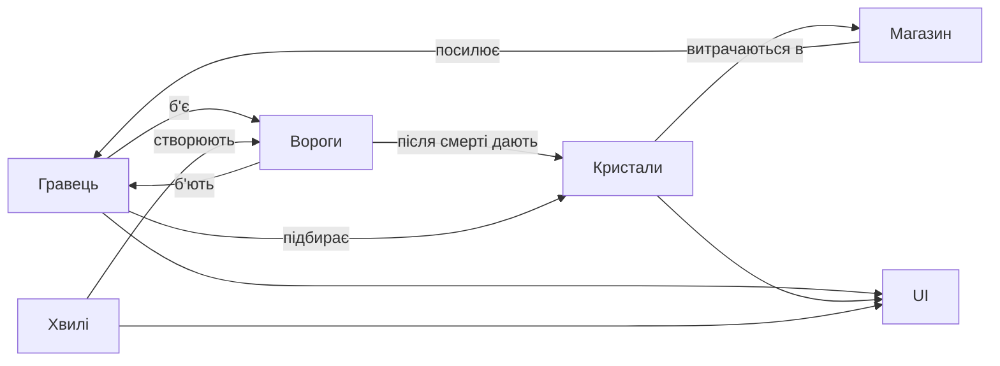

# Схема блоків «Кристальна облога»

Автор: Аліна Мельник

## Пояснення

- **Гравець**: рухається, б'є з кулдауном, має hp.
- **Вороги**: з'являються з хвилі, переслідують і б'ють гравця.
- **Кристали**: лежать на арені, більше там, де більше ворогів.
- **Магазин**: між хвилями, за кристали купуються стіна, турель, швидкість, лікування.
- **Хвилі**: кожна наступна має більше й міцніших ворогів.
- **UI**: показує hp, кристали й номер хвилі.
