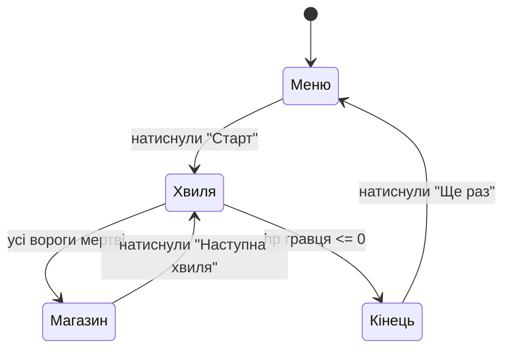
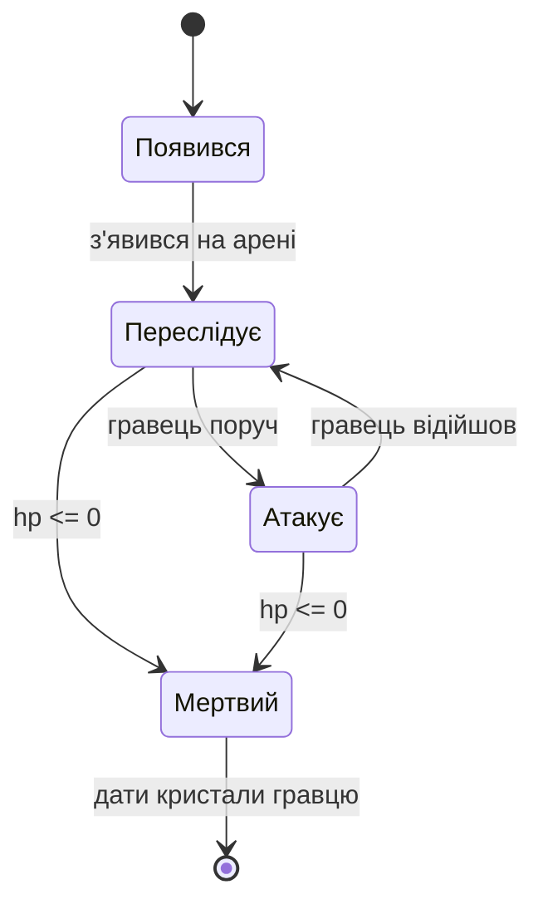

# Діаграма станів гри «Кристальна облога»

Автор: Аліна Мельник

## Пояснення станів

- **Меню**: початковий екран, кнопка «Старт».
- **Хвиля**: гравець б'є ворогів і збирає кристали.
- **Магазин**: між хвилями гравець купує захист за кристали.
- **Кінець**: гравець загинув, показуємо, скільки хвиль він пережив.

## Діаграма станів ворога

- **Появився**: ворог створений на краю арени.
- **Переслідує**: біжить до гравця.
- **Атакує**: б'є гравця, коли той поруч.
- **Мертвий**: зникає, гравець отримує кристали (правило з `pseudocode.md`).
